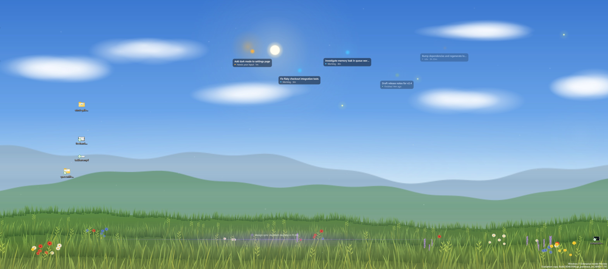
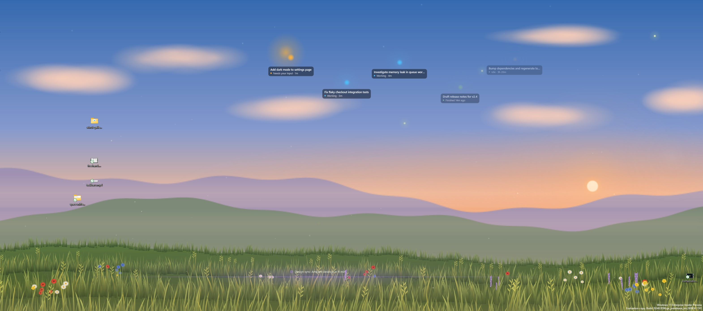
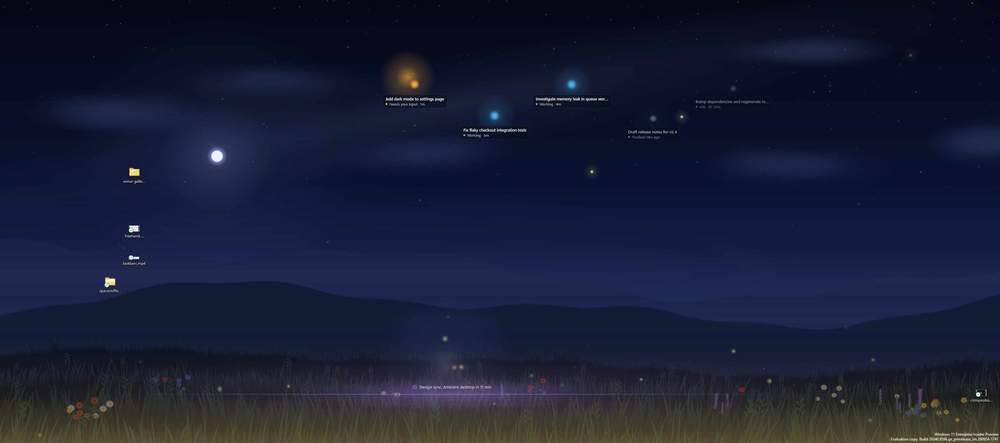
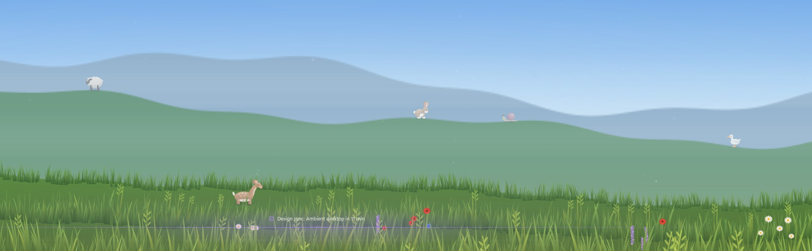
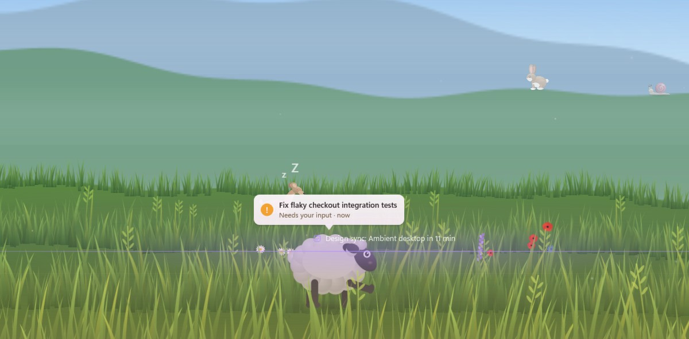
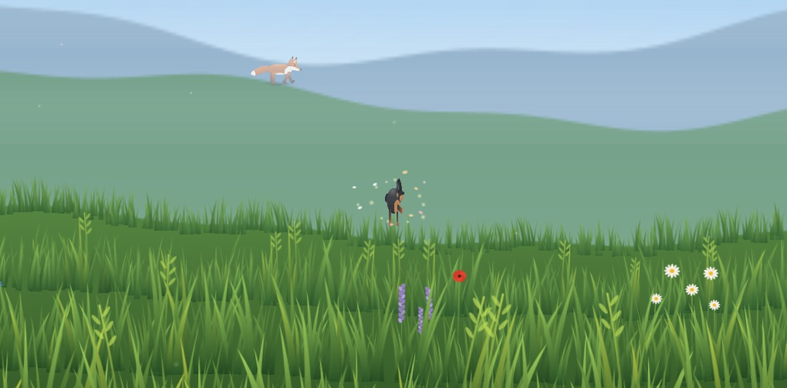
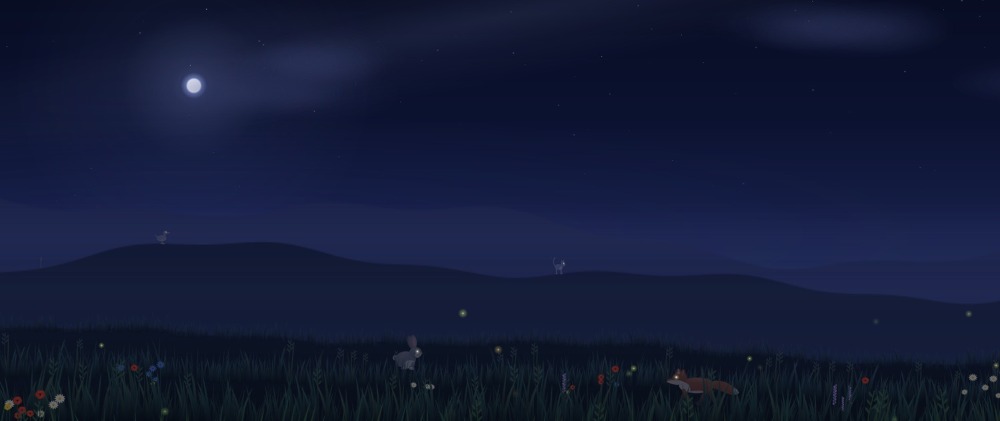

# LiveDesktop

A proof-of-concept **interactive, animated wallpaper** for Windows 10/11. It renders with the Windows
Visual Layer (`Windows.UI.Composition`) into a window that sits **behind the desktop icons**. Icons,
selection, the desktop right-click menu and drag/drop keep working, because LiveDesktop never sits in
the input path.

**Meadow** is a living landscape that follows the **real time of day**: layered hills with atmospheric
haze, a sky that moves through night, blue hour, sunrise, day and golden hour, drifting clouds, stars
and the odd shooting star. Hundreds of grass tufts and wildflowers sway in **traveling gusts of wind**.
The cursor brushes through the grass, fireflies come out at night, and a click on empty desktop space
sends a gust ring and releases dandelion seeds.

Your **Copilot CLI sessions live here as animals** — see [Meadow animals](#meadow-animals).

| Meadow: day | Meadow: golden hour | Meadow: night |
| --- | --- | --- |
|  |  |  |

All motion is driven by composition key-frame and expression animations that run in DWM. The app
only does work when the mouse moves or data changes, so its own CPU use stays near zero (see
[Performance](#performance)).

## Build

Requirements:

- Visual Studio 2022+ or Build Tools with the **x64 C++ workload**. Its bundled CMake and Ninja are used.
- Windows SDK **10.0.22621+**. Its `cppwinrt` headers are used, so no NuGet package is needed.

```cmd
build.cmd            :: Release build -> build\LiveDesktop.exe
build.cmd Debug
```

`build.cmd` uses `vswhere` to find `vcvars64.bat`, then runs `cmake -G Ninja` and builds. You can also
open the folder in Visual Studio (CMake project) or run CMake yourself from a *x64 Native Tools*
prompt.

## Run

```cmd
build\LiveDesktop.exe                 :: start with real data (reads ~\.copilot\session-state)
build\LiveDesktop.exe --mock          :: realistic fake session data (no credentials needed)
build\LiveDesktop.exe --send <cmd>    :: send a command to the running instance (see below)
build\LiveDesktop.exe --stop          :: exit the running instance cleanly
build\LiveDesktop.exe --exit-after 30 :: auto-exit after 30 s (testing)
build\LiveDesktop.exe --no-wallpaper-refresh   :: skip the wallpaper re-apply on exit
build\LiveDesktop.exe --layered       :: experimental: make the host a layered child window
build\LiveDesktop.exe --help
```

- **Tray icon:** right-click opens a menu with *Mock data*, *Pause animations* and *Exit*.
- **`--send` commands** (handy for demos and screenshots):
  - `mock:on|off` toggles mock data, `pause` toggles paused animations, `stop` exits cleanly.
  - `time:<dawn|sunrise|morning|day|afternoon|golden|sunset|dusk|night|HH:MM|auto>` pins the light
    to a time of day (`auto` follows the clock).
  - `agent:list` logs the sessions with their 1-based numbers (sorted by id).
    `agent:<n|id-prefix>:<working|waiting|done|idle>` forces a session's state, for example
    `--send agent:2:waiting`. `agent:<n>:auto` or `agent:auto` drops the override(s).
  - `render:on` keeps animations running even while the desktop is covered (`render:auto` restores
    normal pausing). `snapshot:<path.png>` renders the scene offscreen to a PNG through
    `GraphicsCaptureItem::CreateFromVisual`. This works when windows cover the desktop or the
    workstation is locked. Desktop icons aren't part of the snapshot.
  - `hit:<x>,<y>` logs what a click at that screen point would do, without clicking.
- **Ctrl+C**, the tray **Exit** item, or `WM_CLOSE` all exit cleanly. LiveDesktop removes its window
  and re-applies the current wallpaper so the desktop repaints.
- **Log:** `LiveDesktop.log` is written next to the exe (or `%TEMP%` if that folder isn't writable). It
  also goes to the console and `OutputDebugString`. The log records the detected desktop layout, all
  HWNDs, and the child z-order of the parent window.

Only one instance runs at a time. Nothing is written to the registry or any system setting. The only
file LiveDesktop writes, besides its log, is its own config (below).

## Installing a release build

Tagged releases (`vX.Y.Z`) are built by [CI](.github/workflows/release.yml) and published on the
[Releases](../../releases) page as two downloads:

- **`LiveDesktop-X.Y.Z.msix`** - an MSIX package. This repo has no Microsoft Store or EV code-signing
  certificate, so CI signs it with a throwaway, self-signed certificate generated fresh for that build
  (not reused between releases, not secret, not meant to establish trust by itself). Windows will refuse
  to install an app signed by a certificate it doesn't trust, so pick one:
  - **Trust the release's certificate**: download the matching `LiveDesktop-dev-cert.cer` from the same
    release, double-click it, choose **Install Certificate** → **Local Machine** → **Place all
    certificates in the following store** → **Trusted People**, then install the `.msix` normally.
  - **Enable sideloading** instead of trusting a specific cert: **Settings → Privacy & security → For
    developers** → turn on **Developer Mode** (or just **Install unsigned apps**, on newer builds), then
    install the `.msix`.
  - **Build it yourself** (see [Build](#build) above) - a locally built MSIX only matters if you set up
    your own certificate, so this is really the same as running `build\LiveDesktop.exe` directly.
- **`LiveDesktop-X.Y.Z-win64.zip`** - a portable zip with the plain `.exe`. No install, no signing, no
  certificate prompts - unzip and run `LiveDesktop.exe`. This is the simplest option if you don't want to
  deal with MSIX trust at all.

## How it works

### 1. Getting behind the icons (the "WorkerW" trick)

```
SendMessageTimeout(Progman, 0x052C, 0xD, 0x1, SMTO_NORMAL, 1000)   // then (0, 0) as a fallback
```

`0x052C` is an undocumented message. Explorer uses it to prepare the desktop for the animated
wallpaper cross-fade. It makes Explorer split the desktop so a separate **WorkerW** draws the
wallpaper behind the icon layer (`SHELLDLL_DefView` → `SysListView32`). Where that WorkerW ends up
depends on the Windows version. `DesktopHost.cpp` detects both layouts and logs which one it found:

| | Classic (Windows 10, Windows 11 ≤ 23H2) | Windows 11 24H2+ |
| --- | --- | --- |
| `SHELLDLL_DefView` lives in | a **top-level** `WorkerW` (moved out of Progman) | **Progman** (child) |
| Wallpaper `WorkerW` | the **next top-level sibling** after that window | a **child of Progman** |
| How we find it | `EnumWindows` → window containing `SHELLDLL_DefView` → `FindWindowEx(NULL, thatWindow, "WorkerW", NULL)` | `FindWindowEx(progman, NULL, "WorkerW", NULL)` |
| Our host's parent | that WorkerW | **Progman** |
| Z-order | top of the WorkerW | **just below `SHELLDLL_DefView`, above the WorkerW** |

The host window is created with `WS_EX_NOREDIRECTIONBITMAP`, then switched to
`WS_CHILD | WS_VISIBLE` (no caption) and parented with `SetParent`. It is then sized to the
**virtual screen** (`SM_XVIRTUALSCREEN`… mapped into the parent's client coordinates), so it spans
every monitor. It returns `HTTRANSPARENT` and is `WS_DISABLED`, so even when it is hit-tested it never
takes input. The verified 24H2 z-order looks like this in the log:

```
Detected desktop layout: 24H2+ (WorkerW + SHELLDLL_DefView are children of Progman)
  Children of 0x...1035E (Progman), top to bottom:
    [0] 0x...1036A SHELLDLL_DefView
    [1] 0x...F7018A LiveDesktop.Host  <-- LiveDesktop host
    [2] 0x...B30940 WorkerW
```

### 2. Rendering: Windows.UI.Composition via C++/WinRT

`Scene.cpp` sets up composition on the UI thread:

1. `CreateDispatcherQueueController` (`DQTYPE_THREAD_CURRENT`, STA).
2. A `Compositor`.
3. `ICompositorDesktopInterop::CreateDesktopWindowTarget(hwnd, FALSE)` on the host HWND.

`Meadow.cpp` builds the whole visual tree under one container: sky, ridges, grass, weather and
animals. It uses:

- `CompositionLinearGradientBrush` / `CompositionRadialGradientBrush` with animated stop colors,
  offsets and endpoints for the sky and light.
- `SpriteVisual`s moved by `Vector3KeyFrameAnimation` loops for clouds, grass, fireflies and animals.
- `ExpressionAnimation`s that read a shared **pointer `CompositionPropertySet`** (`Position`), so
  grass bends and fireflies react to the cursor with no per-frame CPU work.

Pausing sets `Compositor.GlobalPlaybackRate` to its minimum.

No Win2D or other dependency is used. Blur is faked with radial gradients that fade to transparent,
which is cheaper than a `GaussianBlurEffect` anyway.

### 3. Interactivity without touching input

The icon layer (`SysListView32`) gets all desktop mouse input, and it has to keep getting it.
LiveDesktop installs a **`WH_MOUSE_LL` hook on a dedicated thread**. The hook:

- only records the cursor position and posts a coalesced message to the UI thread;
- **always calls `CallNextHookEx`** and never swallows input;
- runs on its own thread, so slow UI-thread work (COM calls into Explorer, composition) can never hit
  the low-level hook timeout or make the system mouse lag.

The UI thread then checks `GetAncestor(WindowFromPoint(pt), GA_ROOT)`. It reacts only when that is
`Progman`/`WorkerW`, which means the cursor is over the desktop and not over an app window.

On a click, gusts and seeds fire only over **empty** desktop space. The icon hit test uses the
documented shell automation chain: `IShellWindows::FindWindowSW(SWC_DESKTOP)` → `IShellBrowser` →
`IFolderView::GetItemPosition`. Clicking an animal opens its session (see below) using the same
click-through rules: the hook only observes the click, never swallows it, and a click on a desktop
icon is left alone.

### 4. Robustness

- **Explorer restart:** LiveDesktop handles the `RegisterWindowMessage(L"TaskbarCreated")` broadcast by
  re-adding the tray icon and re-attaching. A 2 s health timer also checks that the parent, DefView
  and host still exist and that the z-order is still correct, and re-attaches if not (it retries
  every second until the desktop is back).
- **Display changes:** `WM_DISPLAYCHANGE`, `WM_DPICHANGED` and `WM_SETTINGCHANGE` are debounced. A
  display signature (virtual screen + monitor rects + DPI) decides whether to resize the host and
  rebuild the scene per monitor. The manifest declares **PerMonitorV2** DPI awareness.
- **Fullscreen apps:** `SHQueryUserNotificationState` (busy / D3D fullscreen / presentation mode) or a
  foreground window that covers its monitor pauses all animations. The log line says which one
  triggered it.
- **Clean exit:** LiveDesktop:
  1. unhooks the mouse;
  2. closes the composition target;
  3. destroys the host window;
  4. removes the tray icon;
  5. re-applies the current wallpaper with `SPI_GETDESKWALLPAPER` → `SPI_SETDESKWALLPAPER(path,
     SPIF_SENDCHANGE)`.

  Step 5 does not use `SPIF_UPDATEINIFILE`, so nothing is persisted.

## Sessions provider and config

Data comes from a single background provider, `SessionsProvider.cpp`. It runs on its own thread, polls
`%USERPROFILE%\.copilot\session-state\<id>\` every few seconds and posts an **immutable snapshot** to
the UI thread through the `DispatcherQueue`. The UI thread only diffs snapshots and updates visuals; it
never waits on file I/O itself. Files are opened read-only with full sharing and are never written.

It reads these signals per session:

| Signal | Used for | Reliability |
| --- | --- | --- |
| `workspace.yaml` (`name` / `summary`, `repository` or `cwd`, `branch`) | label and repo | Good. The name may be the first prompt, so it is trimmed to its first sentence. |
| `inuse.<pid>.lock` + is that PID alive | `live`: a CLI process currently owns the session | Good. Stale lock files from crashed processes are ignored via the PID check. |
| `events.jsonl`, tailed incrementally (last 512 KB at first, then only appended bytes) | status | See the rows below. |
| `assistant.turn_start` / `assistant.turn_end`, pending `tool.execution_start` → `_complete` | **working** | Good while the session is live. |
| a pending `ask_user` / `exit_plan_mode` tool, or `permission.requested` without `permission.completed` | **waiting** (amber) | Good for the CLI's own prompts. Approval prompts drawn only by the app UI might not be logged. |
| `assistant.turn_end` / `session.task_complete` | **done**, and "how long in this state" | Good. Done turns into idle after 20 min. |
| `session.shutdown`, no live lock, or file modification time | idle and recency | Heuristic. A session left open in a window but untouched for hours still counts as live. |
| directory creation time, grouped by `repository` (see [child sessions](#child-sessions-and-sub-agents)) | parent/child linkage | A heuristic, not a source of truth. |

These files are an internal format of the Copilot CLI/app, not an API, so event names can change.
Unknown events are ignored, and a session that can't be parsed simply doesn't get an animal. Clicking
an animal opens `ghapp://sessions/<id>`, the app's own deep link.

- **Failure handling:** a failing poll keeps the last good snapshot and logs once. The next attempt
  backs off exponentially (`interval × 2^failures`, capped at 30 min). Recovery is logged as well.
- **Throttling:** when rendering is paused (fullscreen app, or desktop fully occluded), the provider
  polls 4× less often. Revealing the desktop wakes it immediately.
- **Mock mode:** `--mock` seeds a handful of fake sessions (including a parent/child pair) that move
  between working, waiting and done over time, so the demo works without any real sessions and every
  visual state can be screenshotted. You can toggle it at runtime from the tray (*Mock data*) or
  `--send mock:on|off`.

`%LOCALAPPDATA%\LiveDesktop\config.json` is created with defaults on first run:

```jsonc
{
  "mock": false,
  "providers": {
    "sessions": { "enabled": true, "intervalSeconds": 4, "maxIdleHours": 8, "maxOrbs": 8 }
  }
}
```

## Meadow animals

Each Copilot CLI session becomes a small creature that lives in the landscape and acts out its status.

| Working: busy on the back hills | Waiting: comes to the front and asks |
| --- | --- |
|  |  |
| **Finished: jump, spin and petals** | **Night: silhouettes, eye glints, fireflies** |
|  |  |

| Status | Behaviour |
| --- | --- |
| **working** | Lives far away on the back hills: small, with atmospheric haze applied. It runs a "busy" loop: grazing, digging, carrying things, hopping, nibbling. |
| **waiting** (question / plan approval) | Walks or hops down the hills to the **front**, growing with depth as it comes. There it bounces and waves under a "!" speech bubble with the session name and the ask, e.g. *"Needs your input · 2m"*. It escalates gently, never strobing: bigger hops after 2 min, peeking out of the grass edge after 8 min. |
| **done** | A one-shot celebration (jump + spin + sparkles and petals). Then it wanders to a resting spot mid-ground and lies down. After 10 min it sleeps, with a drifting "zZ". |
| **idle** | Sleeps mid-ground; dropped after `maxIdleHours`. |

- **Terrain-following walks.** State changes are animated journeys along the hill silhouettes (Offset,
  Scale and haze key frames sampled from the terrain), never teleports. Animals hop between depth
  layers inserted *between* the hill and grass layers. A foreground animal is partly hidden by the
  front grass blades, and a back-hill animal stands on the far ridge.
- **Species.** Bunny, fox, sheep, deer, hedgehog, duck, cat, snail, dog (Rottweiler, Golden Doodle,
  White Doodle, chocolate Lab) and squirrel (red, grey, black, golden), in 4 colour/breed variants each. The
  species and variant come from a hash of the session id, so an agent keeps its animal across
  restarts. Up to 10 animals are shown; active ones take priority.
- **Art and rig.** Every species is a multi-part rig (body, head, ears, legs, tail, eyelids, eye glint,
  a carried item). Each part is drawn once with Direct2D geometry into a `CompositionDrawingSurface`.
  Idle bob, walk cycle, hop, wave, blink and sleep are composition key-frame and expression
  animations driven by a per-animal property set, so the CPU stays idle while they move.
- **Light.** Animals are tinted with the sky colour and get darker toward night, where they read as
  silhouettes. Their eyes catch a little light at night. Back-hill animals fade into the haze, and
  each animal has a soft contact shadow that fades while it's in the air.
- **Wind and cursor.** Gusts from the meadow's wind field make ears flutter. Hovering an animal makes
  it look at the cursor and shows a name tag.
- **Click to open.** Clicking an animal opens its session. A waiting animal does a short happy hop
  before the session opens.

### Child sessions and sub-agents

A Copilot CLI session can spawn sub-agents to work on a narrower slice of the same task. There is no
explicit parent/child field on disk, so `SessionsProvider::LinkChildren` infers it from a simple
heuristic: sessions that share a repository are grouped, the earliest-created one in the group is
treated as the "parent" while it is still live, and any sibling created within 30 minutes of it is
linked as a child. This only models one level of nesting and can occasionally misfire (for example,
two unrelated sessions opened back-to-back in the same repo) — it is meant to be a pleasant visual cue,
not a source of truth.

Child animals reuse the same species/rig as any other session, drawn at a smaller scale and spawned
right next to their parent's current position instead of the usual queue slot. They hop in with a
small wave when they appear, and hop out with a wave before fading when they are removed.

The screenshots above were rendered offscreen with `--send snapshot:<path>`, with `--mock` plus
`--send agent:<n>:<state>` posing each state, because the desktop was covered during the run. They
show the wallpaper layer only, with no icons.

## Performance

Measured on a 12-core machine with one 3440×1440 display, over 20–30 s windows (mock data,
`Get-Process` CPU delta):

| State | LiveDesktop CPU |
| --- | --- |
| Meadow with agent animals, rendering forced on (`render:on`) | **0.17% of the machine** (~2% of one core) |
| Meadow with agent animals, desktop covered (normal pausing) | **0.04% of the machine** |
| Fully occluded / fullscreen app | animations paused (`GlobalPlaybackRate` minimum), provider throttled |

Working set is about 65 MB. All animations are composition animations that run in DWM. The UI thread
wakes only for pointer moves, provider snapshots and a 5 s tick for relative-time labels.

## Limitations

- **Undocumented.** Both `0x052C` and the WorkerW/Progman window structure are Explorer internals.
  They changed in 24H2 and may change again. Both known layouts are handled and the log says which
  one was used.
- **Input is observed, not owned.** The desktop never sends mouse messages to our window, which is the
  whole point. The scene can only react to the *global* cursor position and button presses that we
  observe through the hook. Hover and click feedback is approximate: a click that starts an icon drag
  is filtered out only by the icon hit test.
- **Cross-process parenting.** Making our window a child of an Explorer window attaches the two
  threads' input queues. The UI thread must keep pumping messages, and this code never blocks it for
  long. If Explorer crashes, the child window is destroyed with it, and the health timer re-attaches.
- **Low-level hook.** Some security tools flag global hooks. A Raw Input (`RIDEV_INPUTSINK`) variant
  would also work.
- **Wallpaper restore.** Re-applying the wallpaper on exit assumes a single image. With a slideshow,
  Spotlight or a solid color, `SPI_GETDESKWALLPAPER` may return a different or empty path. In that
  case LiveDesktop skips the re-apply and relies on the desktop repainting by itself.
- **GPU.** The animations are cheap, but they keep DWM composing a full-screen surface on every
  frame.
- **Copilot session format.** `session-state` is an internal format of the Copilot CLI/app, not an
  API. Event names can change, and "waiting" only covers prompts that are written to `events.jsonl`.
- **Parent/child linkage is a heuristic.** See [Child sessions and sub-agents](#child-sessions-and-sub-agents).
- **Privacy in screenshots.** Real session titles appear on the desktop. The screenshots in
  `docs/screenshots` were taken with `--mock`.
- **Not a product.** This is a proof of concept: there is no installer, no autostart and no settings
  UI.

## Layout

```
CMakeLists.txt          C++20, static CRT, links windowsapp + CoreMessaging
build.cmd               vswhere -> vcvars64 -> cmake/ninja
src/main.cpp            controller window, tray, hook thread, timers, commands, lifecycle
src/DesktopHost.*       WorkerW / 24H2 discovery, parenting, z-order, bounds
src/Scene.*             compositor, DesktopWindowTarget, pointer property set, pause/resume
src/Meadow.cpp          time-of-day landscape: sky, ridges, wind-swept grass, flowers, fireflies
src/MeadowAnimals.*     Meadow animals: behaviour engine (modes, terrain walks, depth layers, hover/click)
src/MeadowAnimalsArt.*  procedural species rigs (10 species x 4 colour variants) drawn with Direct2D
src/SessionsProvider.*  reads ~\.copilot\session-state, status + parent/child inference, mock data
src/Snapshot.*          offscreen capture of the scene visual to PNG (Windows.Graphics.Capture + WIC)
src/Reveal.*            WinEvent-based "desktop revealed" / "fully occluded" detection
src/Graphics.*          D2D/DirectWrite -> CompositionDrawingSurface (labels, noise)
src/Visuals.*           shared composition helpers (glow/ring brushes, drift, oscillate, ripples)
src/DesktopIcons.*      desktop icon hit testing (IFolderView), so clicks on icons are left alone
src/Config.*            %LOCALAPPDATA%\LiveDesktop\config.json load/save
src/Model.h             shared data model (AgentSession, SessionsSnapshot)
src/Provider.*          background-thread provider base class and snapshot plumbing
src/Util.*, src/Log.*   small helpers: string/time utilities, logging to file + console
```

## License

[MIT](LICENSE).
