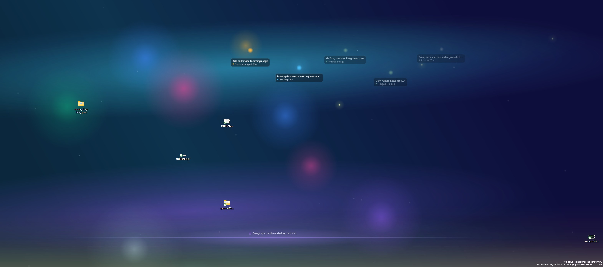
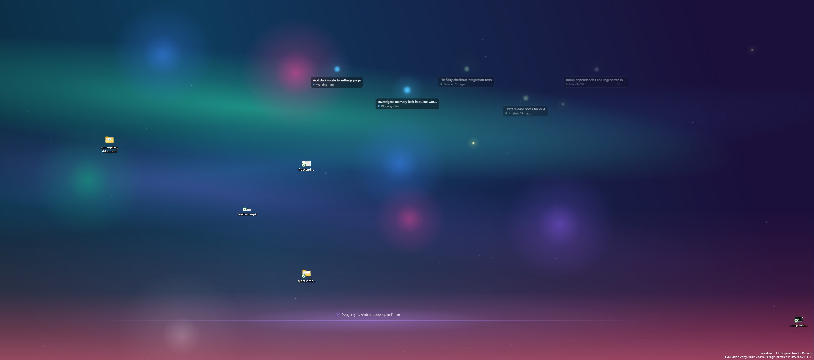
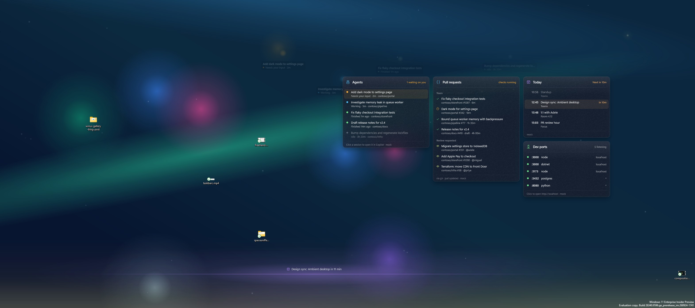
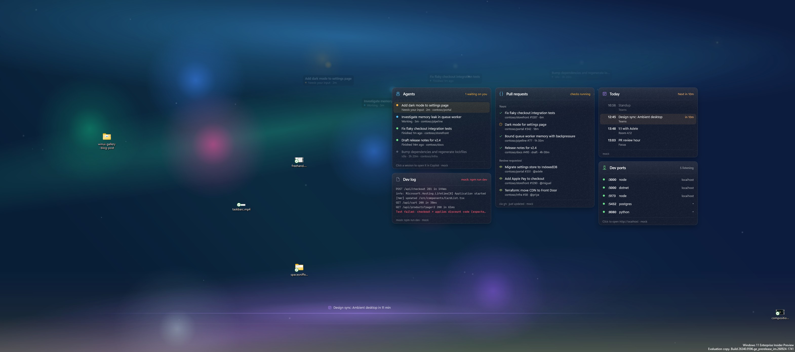
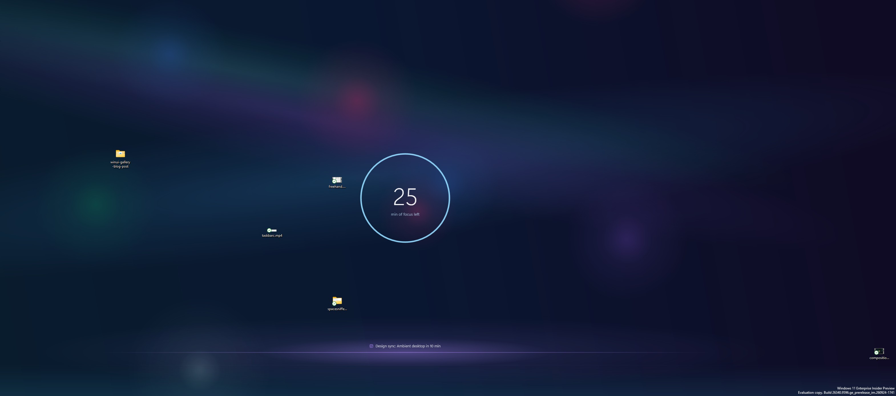

# LiveDesktop

A proof-of-concept **interactive, animated wallpaper** for Windows 10/11. It renders with the Windows
Visual Layer (`Windows.UI.Composition`) into a window that sits **behind the desktop icons**. Icons,
selection, the desktop right-click menu and drag/drop keep working, because LiveDesktop never sits in
the input path.

| Effect | What it does |
| --- | --- |
| **Meadow** (default) | A living landscape that follows the **real time of day**: layered hills with atmospheric haze, a sky that moves through night, blue hour, sunrise, day and golden hour, drifting clouds, stars and the odd shooting star. Hundreds of grass tufts and wildflowers sway in **traveling gusts of wind**. The cursor brushes through the grass, fireflies come out at night, and a click on empty desktop space sends a gust ring and releases dandelion seeds. |
| **Aurora** | Rotating gradient sky, waving aurora curtains, and soft orbs that drift and **move away from the cursor**. Clicking empty desktop space sends out ripples. |
| **Fireflies** | Night sky with nebula glows and hundreds of twinkling sparks that **gather toward the cursor**. Clicking empty desktop space gives a spark burst and a ripple. |
| **Ember** | The Aurora scene with a warm palette. |

| Meadow: day | Meadow: golden hour | Meadow: night |
| --- | --- | --- |
|  |  |  |

All motion is driven by composition key-frame and expression animations that run in DWM. The app
only does work when the mouse moves or data changes, so its own CPU use stays near zero (see
[Performance](#performance)).

On top of that, LiveDesktop is an **Ambient Dev Desktop** prototype:

- An **ambient layer** that is always visible: Copilot agent orbs, a CI/PR "tide", review-request
  fireflies, a subtle system pulse and a next-meeting horizon.
- A **productivity dashboard** of glassy, clickable cards that appears when you reveal the desktop
  (Win+D).
- A **clipboard shelf** in the bottom-right corner: your recent clipboard history as a stack of
  cards. Click one to put it back on the clipboard, or drag files or text onto it to keep them there.

| Ambient: agent orbs + meeting horizon | Ambient: one of my PRs has failing checks |
| --- | --- |
|  |  |
| **Win+D: dashboard (default scene)** | **Win+D: "work" scene with the dev log card** |
|  |  |
| **"Focus" scene: calm, focus timer** | |
|  | |

All screenshots use `--mock` data and were captured live from the desktop, behind real icons. They are
cropped to leave out the taskbar and the left icon columns.

## Build

Requirements:

- Visual Studio 2022+ or Build Tools with the **x64 C++ workload**. Its bundled CMake and Ninja are used.
- Windows SDK **10.0.22621+**. Its `cppwinrt` headers are used, so no NuGet package is needed.

```cmd
build.cmd            :: Release build -> build\LiveDesktop.exe
build.cmd Debug
```

`build.cmd` uses `vswhere` to find `vcvars64.bat`, then runs `cmake -G Ninja` and builds. You can also
open the folder in Visual Studio (CMake project) or run CMake yourself from a *x64 Native Tools*
prompt.

## Run

```cmd
build\LiveDesktop.exe                 :: start with real data providers (console shows the log)
build\LiveDesktop.exe --mock          :: realistic fake data for every provider (no credentials needed)
build\LiveDesktop.exe --mock --dashboard   :: ...and force the dashboard on (no Win+D needed)
build\LiveDesktop.exe --scene focus   :: force a scene: default | work | focus
build\LiveDesktop.exe --effect 1      :: start with Aurora (0 Meadow, 1 Aurora, 2 Fireflies, 3 Ember)
build\LiveDesktop.exe --next          :: switch effect in the running instance
build\LiveDesktop.exe --send <cmd>    :: send a command to the running instance (see below)
build\LiveDesktop.exe --stop          :: exit the running instance cleanly
build\LiveDesktop.exe --exit-after 30 :: auto-exit after 30 s (testing)
```

- **Tray icon:** left-click switches to the next effect. Right-click opens a menu with *Next effect*,
  *Next scene*, *Force dashboard*, *Mock data*, *Clipboard shelf*, *Pause animations* and *Exit*.
- **`--send` commands** (handy for demos and screenshots): `next-effect`, `effect:<n>`, `next-scene`,
  `scene:<default|work|focus|auto>`, `dashboard:<on|off|auto>`, `mock:<on|off>`,
  `ci:<red|green|mixed>` (mock CI state), `log:<error|ok>` (mock log line), `pause`, `stop`, and
  `hit:<x>,<y>` (logs what a click at that screen point would do, without clicking).
  - Meadow: `time:<dawn|sunrise|morning|day|afternoon|golden|sunset|dusk|night|HH:MM|auto>` pins
    the light to a time of day (`auto` follows the clock).
  - Clipboard shelf: `stack:<open|close|auto>` (fan out / collapse), `stack:<drop|nodrop>` (preview
    the drop target), `stack:<on|off>`, and `clip:<text>` (push text onto the shelf and clipboard).
- **Ctrl+C**, the tray **Exit** item, or `WM_CLOSE` all exit cleanly. LiveDesktop removes its window
  and re-applies the current wallpaper so the desktop repaints.
- **Log:** `LiveDesktop.log` is written next to the exe (or `%TEMP%` if that folder isn't writable). It
  also goes to the console and `OutputDebugString`. The log records the detected desktop layout, all
  HWNDs, and the child z-order of the parent window.
- **Other flags:** `--no-wallpaper-refresh` skips the wallpaper re-apply on exit. `--layered`
  experimentally makes the host a `WS_EX_LAYERED` child, which some 24H2 builds/drivers may need.

Only one instance runs at a time. Nothing is written to the registry or any system setting. The only
file LiveDesktop writes, besides its log, is its own config (below).

## How it works

### 1. Getting behind the icons (the "WorkerW" trick)

```
SendMessageTimeout(Progman, 0x052C, 0xD, 0x1, SMTO_NORMAL, 1000)   // then (0, 0) as a fallback
```

`0x052C` is an undocumented message. Explorer uses it to prepare the desktop for the animated
wallpaper cross-fade. It makes Explorer split the desktop so a separate **WorkerW** draws the
wallpaper behind the icon layer (`SHELLDLL_DefView` → `SysListView32`). Where that WorkerW ends up
depends on the Windows version. `DesktopHost.cpp` detects both layouts and logs which one it found:

| | Classic (Windows 10, Windows 11 ≤ 23H2) | Windows 11 24H2+ |
| --- | --- | --- |
| `SHELLDLL_DefView` lives in | a **top-level** `WorkerW` (moved out of Progman) | **Progman** (child) |
| Wallpaper `WorkerW` | the **next top-level sibling** after that window | a **child of Progman** |
| How we find it | `EnumWindows` → window containing `SHELLDLL_DefView` → `FindWindowEx(NULL, thatWindow, "WorkerW", NULL)` | `FindWindowEx(progman, NULL, "WorkerW", NULL)` |
| Our host's parent | that WorkerW | **Progman** |
| Z-order | top of the WorkerW | **just below `SHELLDLL_DefView`, above the WorkerW** |

The host window is created with `WS_EX_NOREDIRECTIONBITMAP`, then switched to
`WS_CHILD | WS_VISIBLE` (no caption) and parented with `SetParent`. It is then sized to the
**virtual screen** (`SM_XVIRTUALSCREEN`… mapped into the parent's client coordinates), so it spans
every monitor. It returns `HTTRANSPARENT` and is `WS_DISABLED`, so even when it is hit-tested it never
takes input. The verified 24H2 z-order looks like this in the log:

```
Detected desktop layout: 24H2+ (WorkerW + SHELLDLL_DefView are children of Progman)
  Children of 0x...1035E (Progman), top to bottom:
    [0] 0x...1036A SHELLDLL_DefView
    [1] 0x...F7018A LiveDesktop.Host  <-- LiveDesktop host
    [2] 0x...B30940 WorkerW
```

### 2. Rendering: Windows.UI.Composition via C++/WinRT

`Scene.cpp` sets up composition on the UI thread:

1. `CreateDispatcherQueueController` (`DQTYPE_THREAD_CURRENT`, STA).
2. A `Compositor`.
3. `ICompositorDesktopInterop::CreateDesktopWindowTarget(hwnd, FALSE)` on the host HWND.

Each effect (`Effects.cpp`) builds a visual tree under one container. It uses:

- `CompositionLinearGradientBrush` / `CompositionRadialGradientBrush` with animated stop colors,
  offsets and endpoints.
- `SpriteVisual`s moved by `Vector3KeyFrameAnimation` loops.
- `ExpressionAnimation`s that read a shared **pointer `CompositionPropertySet`** (`Position`,
  `Strength`, `Radius`). This is how orbs move away from the cursor and sparks gather toward it, with
  no per-frame CPU work.

Switching effects cross-fades the old and new trees. Pausing sets `Compositor.GlobalPlaybackRate` to
its minimum.

No Win2D or other dependency is used. Blur is faked with radial gradients that fade to transparent,
which is cheaper than a `GaussianBlurEffect` anyway.

### 3. Interactivity without touching input

The icon layer (`SysListView32`) gets all desktop mouse input, and it has to keep getting it.
LiveDesktop installs a **`WH_MOUSE_LL` hook on a dedicated thread**. The hook:

- only records the cursor position and posts a coalesced message to the UI thread;
- **always calls `CallNextHookEx`** and never swallows input;
- runs on its own thread, so slow UI-thread work (COM calls into Explorer, composition) can never hit
  the low-level hook timeout or make the system mouse lag.

The UI thread then checks `GetAncestor(WindowFromPoint(pt), GA_ROOT)`. It reacts only when that is
`Progman`/`WorkerW`, which means the cursor is over the desktop and not over an app window.

On a click, ripples fire only over **empty** desktop space. The icon hit test uses the documented
shell automation chain: `IShellWindows::FindWindowSW(SWC_DESKTOP)` → `IShellBrowser` →
`IFolderView::GetItemPosition`.

### 4. Robustness

- **Explorer restart:** LiveDesktop handles the `RegisterWindowMessage(L"TaskbarCreated")` broadcast by
  re-adding the tray icon and re-attaching. A 2 s health timer also checks that the parent, DefView
  and host still exist and that the z-order is still correct, and re-attaches if not (it retries
  every second until the desktop is back).
- **Display changes:** `WM_DISPLAYCHANGE`, `WM_DPICHANGED` and `WM_SETTINGCHANGE` are debounced. A
  display signature (virtual screen + monitor rects + DPI) decides whether to resize the host and
  rebuild the scene per monitor. The manifest declares **PerMonitorV2** DPI awareness.
- **Fullscreen apps:** `SHQueryUserNotificationState` (busy / D3D fullscreen / presentation mode) or a
  foreground window that covers its monitor pauses all animations. The log line says which one
  triggered it.
- **Clean exit:** LiveDesktop:
  1. unhooks the mouse;
  2. closes the composition target;
  3. destroys the host window;
  4. removes the tray icon;
  5. re-applies the current wallpaper with `SPI_GETDESKWALLPAPER` → `SPI_SETDESKWALLPAPER(path,
     SPIF_SENDCHANGE)`.

  Step 5 does not use `SPIF_UPDATEINIFILE`, so nothing is persisted.

## Ambient Dev Desktop

### Providers and config

Data comes from **providers** (`Provider.*`, `*Provider*.cpp`). Each one runs on its own background
thread, polls (or watches) its source and posts an **immutable snapshot** to the UI thread through the
`DispatcherQueue`. The UI thread only diffs snapshots and updates visuals. It never waits on I/O,
`gh`, COM calendar calls or the network.

- **Failure handling:** a failing poll keeps the last good snapshot and logs once. The next attempt
  backs off exponentially (`interval × 2^failures`, capped at 30 min). Recovery is logged as well.
- **Throttling:** when rendering is paused (fullscreen app, or desktop fully occluded), the system
  pulse stops and every other provider polls 4× less often. Revealing the desktop wakes the sessions
  and ports providers immediately.
- **Mock mode:** every provider has a `--mock` mode with realistic fake data that changes over time:
  agents move between working, waiting and done, and meetings count down. The demo therefore works
  without credentials, and every visual state can be screenshotted. You can toggle it at runtime from
  the tray (*Mock data*).

`%LOCALAPPDATA%\LiveDesktop\config.json` is created with defaults on first run:

```jsonc
{
  "mock": false,
  "repos": [],                       // empty = all of my open PRs; or ["owner/name", ...]
  "providers": {
    "sessions": { "enabled": true, "intervalSeconds": 4, "maxIdleHours": 8, "maxOrbs": 8 },
    "github":   { "enabled": true, "intervalSeconds": 120 },
    "system":   { "enabled": true, "intervalSeconds": 3 },
    "calendar": { "enabled": true, "intervalSeconds": 300, "icsUrl": "" },   // https ICS feed
    "ports":    { "enabled": true, "intervalSeconds": 10 },
    "logTail":  { "enabled": false, "intervalSeconds": 2, "path": "", "lines": 6 },
    "clipboard": { "enabled": true, "items": 12 },                           // history size, 3-24
    "worktrees": { "enabled": true, "intervalSeconds": 30, "max": 5, "paths": [] }   // extra local repos
  },
  "scenes": {
    "default": "default",            // scene for unmapped virtual desktops
    "focusMinutes": 25,
    "desktops": { "{GUID}": "work", "Focus": "focus", "3": "focus" }   // by GUID, name or 1-based index
  }
}
```

### Concept 1: the ambient layer

**Copilot agent orbs** (`SessionsProvider.cpp`). Each recently active Copilot CLI / Copilot app session
becomes a floating orb with a small label. The label is drawn with DirectWrite into a
`CompositionDrawingSurface`. The orb's status drives its animation:

| Status | Look |
| --- | --- |
| working | slow pulse |
| waiting for you (question / plan approval / permission) | amber glow and a gentle bob |
| just finished | one-shot burst, then fades to a dim idle state over ~20 min |
| idle | dim; dropped after `maxIdleHours` (8 h) |

The provider reads `%USERPROFILE%\.copilot\session-state\<id>\` **read-only**. Files are opened with
full sharing and are never written. It uses these signals:

| Signal | Used for | Reliability |
| --- | --- | --- |
| `workspace.yaml` (`name` / `summary`, `repository` or `cwd`, `branch`) | label and repo | Good. The name may be the first prompt, so it is trimmed to its first sentence. |
| `inuse.<pid>.lock` + is that PID alive | `live`: a CLI process currently owns the session | Good. Stale lock files from crashed processes are ignored via the PID check. |
| `events.jsonl`, tailed incrementally (last 512 KB at first, then only appended bytes) | status | See the rows below. |
| `assistant.turn_start` / `assistant.turn_end`, pending `tool.execution_start` → `_complete` | **working** | Good while the session is live. |
| a pending `ask_user` / `exit_plan_mode` tool, or `permission.requested` without `permission.completed` | **waiting** (amber) | Good for the CLI's own prompts. Approval prompts drawn only by the app UI might not be logged. |
| `assistant.turn_end` / `session.task_complete` | **done**, and "how long in this state" | Good. Done turns into idle after 20 min. |
| `session.shutdown`, no live lock, or file modification time | idle and recency | Heuristic. A session left open in a window but untouched for hours still counts as live. |

These files are an internal format of the Copilot CLI/app, not an API, so event names can change.
Unknown events are ignored, and a session that can't be parsed simply doesn't get an orb. Clicking a
session on the dashboard opens `ghapp://sessions/<id>`, the app's own deep link.

**CI / PR tide** (`GitHubProvider.cpp`). This uses the `gh` CLI and your existing `gh auth login`, so
no tokens are stored.

- With no repos configured, a single `gh api graphql` call returns my open PRs, each with
  `statusCheckRollup`, plus my review requests.
- With repos configured, it runs `gh pr list --repo X --author @me --json …,statusCheckRollup` and
  `--search review-requested:@me` for each repo.

If any of my PRs has a failing check, a soft **red glow rises from the bottom edge**. Pending checks
give a faint amber glow, and all-green is calm. **Review requests drift in as fireflies.** `gh`
runs hidden (`CREATE_NO_WINDOW`) with a timeout.

**System pulse** (`SystemProviders.cpp`):

- **CPU** (`GetSystemTimes`) sets the playback rate of a shared phase clock, so dust and particles
  move faster under load.
- **Memory load** (`GlobalMemoryStatusEx`) raises a faint tinted "water level" at the bottom.
- **GPU 3D utilisation** (PDH `\GPU Engine(*engtype_3D)\Utilization Percentage`, sampled every third
  poll) adds a warm ember tint.

All three effects are intentionally very subtle.

**Next-meeting horizon** (`CalendarProvider.cpp`): a thin line of light with *"Design sync in 12
min"* near the bottom. It brightens as the meeting approaches.

### Concept 2: the productivity reveal (Win+D)

**Detecting "desktop revealed"** (`Reveal.cpp`). Out-of-context `SetWinEventHook` hooks listen for
`EVENT_SYSTEM_FOREGROUND`, `MINIMIZESTART/END`, show/hide, cloak/uncloak and location changes. The
events are coalesced into one posted message and evaluated 120 ms later. The desktop counts as
**revealed** when either:

- the foreground window is `Progman`, `WorkerW` or `SHELLDLL_DefView` (this is what Win+D does on
  24H2); or
- no visible, non-minimized, non-cloaked app window remains on the primary monitor.

Tool windows, transparent/no-activate overlays, shell windows, tiny windows and our own windows are
ignored. The same pass also subtracts every window rectangle from the desktop region (`HRGN`). If
less than 0.5% is still visible, the desktop is **fully occluded** and rendering pauses.

**Dashboard** (`Dashboard.cpp`). When the desktop is revealed, the cards rise and fade in (staggered,
400 ms, composition easing) and the ambient orbs dim. When you switch back to an app, the cards fade
out. Cards:

- **Agents:** each session, its status, and how long it has been in that status.
- **Pull requests:** mine (with check state) plus review requests.
- **Today:** meetings, with "next in X min".
- **Dev ports:** listening TCP ports with process names, e.g. `:5173 node`. It uses
  `GetExtendedTcpTable(TCP_TABLE_OWNER_PID_LISTENER)` for IPv4 and IPv6 and filters out system
  services.
- **Dev log** ("work" scene, when `logTail.path` is set): the last N lines, highlighted and flashing
  on lines matching error / fail / exception / fatal.
- **Working trees** (`WorktreesProvider.cpp`): the repos you're actually touching, showing branch,
  ahead/behind and staged / modified / new counts, colored by state (conflicts → red, dirty → amber,
  unpushed → blue, clean → green). Repos come from `worktrees.paths` plus the `git_root` of every
  Copilot session active in the last 7 days, so the repos your agents are working in appear
  automatically. Each repo runs `git --no-optional-locks status --porcelain=v2 --branch` every 30 s,
  which never takes `index.lock` and never touches the network. Clicking a row opens the folder in
  Explorer.

The cards are glass: a tinted semi-transparent fill, a generated noise texture, a 1 px highlight
border, rounded corners and a `DropShadow`. Text uses Segoe UI Variable and Segoe Fluent Icons.

**Layout away from the icons.** Icon positions come from `IFolderView::GetItemPosition` via
`IShellWindows`. The cards go into the largest icon-free region of the primary monitor's work area,
or the right two-thirds if icon positions aren't available. They are packed in columns and re-laid
out when icons move or the display changes.

**Clickable cards without taking input.** The desktop icon layer still gets every mouse message. The
low-level hook (which always calls `CallNextHookEx`) also reports button-down and button-up events.
A **click** is a down and an up within 6 px and 600 ms, on the same card row, while the dashboard is
visible, with the cursor over the desktop (`WindowFromPoint`) and **not over an icon** (icon hit
test). A click like that opens the row's target:

- a PR opens its URL;
- a port opens `http://localhost:<port>`;
- a session opens `ghapp://sessions/<id>`.

Drags and rubber-band selections never match. A click on an icon that sits over a card goes to the
icon as usual. Hover highlights follow the cursor.

**Per-virtual-desktop scenes.** The current virtual desktop is read from
`HKCU\…\Explorer\VirtualDesktops\CurrentVirtualDesktop` (names come from `…\Desktops\{GUID}\Name`)
and watched with `RegNotifyChangeKeyValue`. `scenes.desktops` maps a GUID, name or 1-based index to a
preset:

| Preset | What it shows |
| --- | --- |
| `work` | full dashboard, including the dev log card, plus all orbs |
| `focus` | a calm, dimmed scene with only orbs that need you, no dashboard and a large focus timer (`focusMinutes`) |
| `default` | everything except the dev log card |

Switching desktops clears a scene override set from the tray (*Next scene*).

### Clipboard shelf

The bottom-right corner of the desktop holds your recent clipboard history as a **stack of glass
cards**. It is always visible; in the focus scene it is dimmed.

- **Peek:** the top three cards are stacked like a deck under a "CLIPBOARD · n" caption. Each card
  shows a type glyph, a preview, the source app and how long ago it was copied.
- **Fan out:** hovering over the stack spreads it into a column of up to 8 cards.
- **Copy:** clicking a card puts it back on the clipboard (same click rules as the dashboard), and a
  small "Copied" toast confirms it.
- **Kinds:** cards are typed. Text, code (multi-line with code markers), shell commands, URLs, colors
  (`#rrggbb` / `rgb()`, shown with a swatch), images (`CF_DIB`, shown as a thumbnail) and files
  (`CF_HDROP`, shown with names and count).
- **Drag to keep:** drag files or text from any app onto the stack and they are stored as a new card
  and placed on the clipboard. Dropped files are referenced, not copied or moved.

**How capture works** (`Clipboard.cpp`). A dedicated thread owns a message-only window registered with
`AddClipboardFormatListener`. On `WM_CLIPBOARDUPDATE` it opens the clipboard with a short retry,
copies what it needs and closes it right away. Identical consecutive copies are merged, and a copy
of an existing item moves it to the top.

**Privacy.** History lives **in memory only** and is never written to disk or the log. Content is
skipped when the source app marks it private, using the same conventions as Windows clipboard
history and password managers:

- `ExcludeClipboardContentFromMonitorProcessing`;
- `CanIncludeInClipboardHistory` = 0;
- `Clipboard Viewer Ignore`.

Text that looks like a token (`ghp_…`, `github_pat_…`, `sk-…`, `xoxb-…`, `AKIA…`, JWTs …) is kept
but **shown masked** ("Secret, hidden"). Turning the shelf off from the tray or with
`--send stack:off` stops the listener and clears the history.

**Drop target without blocking the desktop** (`DropWindow.cpp`). The wallpaper window can't take part
in OLE drag and drop, because it is never in the input path. Instead the mouse hook watches for a
left-button drag (more than 8 px) that enters the shelf's drop zone over the desktop. Only then does
LiveDesktop show a small, nearly transparent (`WS_EX_LAYERED`, alpha 1), topmost,
`WS_EX_NOACTIVATE` window over the zone, registered with `RegisterDragDrop`.

- The window uses `IDropTargetHelper`, so the drag image keeps rendering.
- It accepts `CF_HDROP` and text with **`DROPEFFECT_COPY` only**, and lights up the shelf while hovered.
- It is hidden as soon as the drag leaves the zone, or 500 ms after the button is released.
- Outside of a drag it doesn't exist on screen, so it never intercepts clicks.

### What's real and what's mocked

| Provider | Real source | Status on the dev machine |
| --- | --- | --- |
| Copilot sessions | `~\.copilot\session-state` | **Real.** Live sessions, including this one, show as working / done / idle. |
| GitHub PRs and review requests | `gh` CLI | **Real.** 20 of my PRs (one failing → red tide) and review requests. |
| System pulse | Win32 + PDH | **Real.** |
| Dev ports | `GetExtendedTcpTable` | **Real.** Shows "No dev servers listening" when nothing is running. |
| Calendar | `AppointmentStore`, then `icsUrl`, then mock | **Partly real.** `AppointmentStore` opened from the unpackaged exe but held no meetings, because Outlook/Microsoft 365 calendars aren't synced into the Windows calendar store. Set `icsUrl` (e.g. an Outlook "publish calendar" ICS link) for real meetings. If neither source is available, the provider falls back to mock meetings. |
| Dev log | file tail (`logTail.path`) | **Real** when configured; off by default. |
| Working trees | `git status --porcelain=v2` | **Real.** Picked up 5 repos from recent sessions (e.g. `LiveDesktop@main`, 17 changed files). |
| Clipboard shelf | `AddClipboardFormatListener` | **Real** clipboard. `--mock` seeds the shelf with sample items (code, URL, color, command, image, files, a masked token, text). |

### Performance

Measured on a 12-core machine with one 3440×1440 display, over 20–30 s windows (mock data,
`Get-Process` CPU delta):

| State | LiveDesktop CPU |
| --- | --- |
| Desktop covered by app windows (user actively working) | **0.17% of the machine** (~2% of one core) |
| Desktop revealed, dashboard visible, animations running | **0.09% of the machine** (~1% of one core) |
| Fully occluded / fullscreen app | animations paused (`GlobalPlaybackRate` minimum), providers throttled |

Working set is about 65 MB. All animations are composition animations that run in DWM. The UI thread
wakes only for pointer moves, provider snapshots and a 5 s tick for relative-time labels.

## Limitations

- **Undocumented.** Both `0x052C` and the WorkerW/Progman window structure are Explorer internals.
  They changed in 24H2 and may change again. Both known layouts are handled and the log says which
  one was used.
- **Input is observed, not owned.** The desktop never sends mouse messages to our window, which is the
  whole point. Effects can only react to the *global* cursor position and button presses that we
  observe through the hook. Hover and drag feedback is approximate: for example, a click that starts
  an icon drag is filtered out only by the icon hit test.
- **Cross-process parenting.** Making our window a child of an Explorer window attaches the two
  threads' input queues. The UI thread must keep pumping messages, and this code never blocks it for
  long. If Explorer crashes, the child window is destroyed with it, and the health timer re-attaches.
- **Low-level hook.** Some security tools flag global hooks. A Raw Input (`RIDEV_INPUTSINK`) variant
  would also work.
- **Wallpaper restore.** Re-applying the wallpaper on exit assumes a single image. With a slideshow,
  Spotlight or a solid color, `SPI_GETDESKWALLPAPER` may return a different or empty path. In that
  case LiveDesktop skips the re-apply and relies on the desktop repainting by itself.
- **GPU.** The animations are cheap, but they keep DWM composing a full-screen surface on every
  frame.
- **Copilot session format.** `session-state` is an internal format of the Copilot CLI/app, not an
  API. Event names can change, and "waiting" only covers prompts that are written to `events.jsonl`.
- **Cards are clicked through a hook.** A card click is inferred from observed button events, so the
  icon layer still receives the click too: a single click on empty desktop space also clears the
  icon selection, as it normally does. Opening a target happens on button-up and can't be cancelled.
- **Calendar.** An unpackaged exe can open the Windows `AppointmentStore`, but most work calendars
  aren't synced into it. Use `icsUrl` instead. The ICS parser handles plain `VEVENT`s with
  `DTSTART`/`DTEND` (UTC, floating or all-day). `TZID` times are treated as local time, and recurring
  events (`RRULE`) are not expanded.
- **GitHub.** Polling uses `gh` and its rate limit. The default interval is 2 min, and back-off kicks in
  on errors.
- **Clipboard.** The shelf only sees what reaches the clipboard while LiveDesktop runs. Its history
  is in memory and is lost on exit. Delayed-rendered formats are materialized when the clipboard
  changes, which is what all clipboard managers do. Only text, files and images are kept: rich
  formats (HTML, RTF, app-private) are not, so copying a card back gives plain text. Dropping onto
  the shelf needs the shelf's corner of the desktop to be visible.
- **Privacy in screenshots.** Real session titles and PR titles appear on the desktop. The screenshots
  in `docs/screenshots` were taken with `--mock`.
- **Not a product.** This is a proof of concept: there is no installer, no autostart and no settings
  UI.

## Layout

```
CMakeLists.txt          C++20, static CRT, links windowsapp + CoreMessaging
build.cmd               vswhere -> vcvars64 -> cmake/ninja
src/main.cpp            controller window, tray, hook thread, timers, commands, lifecycle
src/DesktopHost.*       WorkerW / 24H2 discovery, parenting, z-order, bounds
src/Scene.*             compositor, DesktopWindowTarget, pointer property set, pause, effect switching
src/Effects.cpp         Aurora / Fireflies / Ember wallpaper effects
src/Meadow.cpp          Meadow: time-of-day landscape, wind-swept grass, flowers, fireflies
src/Ambient.*           ambient layer: agent orbs, CI tide, fireflies, system pulse, horizon, focus timer
src/Dashboard.*         glass cards, layout around icons, hit test / hover / click targets
src/Reveal.*            WinEvent-based "desktop revealed" / "fully occluded" detection
src/Presets.h           scene presets (default / work / focus)
src/Graphics.*          D2D/DirectWrite -> CompositionDrawingSurface (labels, card text, noise)
src/Visuals.*           shared composition helpers (glow/ring brushes, drift, oscillate, ripples)
src/Config.*            %LOCALAPPDATA%\LiveDesktop\config.json load / defaults
src/Model.h             immutable snapshot types
src/Provider.*          provider base: thread, back-off, throttle, mock switch
src/Providers.h         provider declarations
src/SessionsProvider.cpp  Copilot session-state reader
src/GitHubProvider.cpp  gh CLI PRs / checks / review requests
src/CalendarProvider.cpp  AppointmentStore / ICS / mock
src/SystemProviders.cpp CPU / memory / GPU, listening ports, log tail, virtual desktop watch
src/WorktreesProvider.cpp  git status of configured repos + repos of recent Copilot sessions
src/Clipboard.*         clipboard listener thread, privacy filters, history, copy-back
src/ClipboardStack.*    clipboard shelf visuals (peek / fan / drop zone / toast)
src/DropWindow.*        transient OLE drop target shown only while dragging onto the shelf
src/DesktopIcons.*      IFolderView-based icon positions and hit test
src/Util.*              process spawning, strings, time formatting
src/AppIcon.cpp         tray icon generated at runtime
src/Log.*               file + console logging
src/LiveDesktop.manifest  PerMonitorV2, Windows 10/11 supportedOS
docs/screenshots/       mock-data screenshots of each state
```
